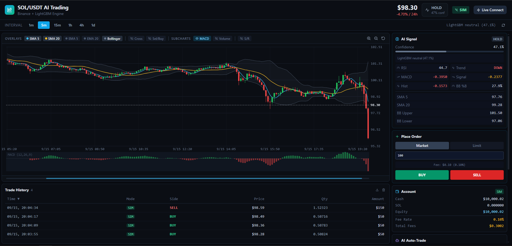

# SOL/USDT AI Trading Dashboard

A web dashboard for trading **SOL/USDT** on Binance. It shows a live price chart, gives AI buy/sell signals, and lets you practice trading with fake money or trade for real.



## What it does

- **Live chart**: candlesticks with 1m, 5m, 15m, 1h, 4h and 1d timeframes. Drag to scroll, drag the price axis to stretch, double-click to reset.
- **Indicators**: moving averages, RSI, MACD and Bollinger Bands.
- **Support and resistance**: finds the price levels that held most often and draws them on the chart.
- **AI signals**: a machine learning model (LightGBM) predicts whether the next candle is likely to go up or down. If the model isn't ready, a simpler rule-based signal is used.
- **Two trading modes**:
  - **SIM**: practice with fake money. No risk.
  - **LIVE**: real orders on your Binance account (or the Binance Testnet).

## How it works

The app has two parts, and both must be running:

| Part     | Tech                   | Address                   |
| -------- | ---------------------- | ------------------------- |
| Frontend | React + Vite           | http://127.0.0.1:5173     |
| Backend  | Python + FastAPI       | http://localhost:8001/api |

The frontend (what you see in the browser) gets all its data from the backend.

## Setup

You need **Python 3.10+** and **Node.js 18+**.

### 1. Start the backend

```bash
cd src/backend
pip install -r requirements.txt
python -m uvicorn server:app --host 0.0.0.0 --port 8001 --reload
```

Leave this terminal open.

### 2. Start the frontend

Open a second terminal in the project folder:

```bash
npm install
npm run dev
```

### 3. Open the app

Go to **http://127.0.0.1:5173** in your browser.

## Live trading (optional)

The app starts in **SIM** mode. To trade for real, click **Connect** in the app and enter your Binance API key and secret.

Stay safe:

- Try the **Testnet** option first.
- In Binance, turn on **Spot Trading** only. Never turn on withdrawals.
- Set a **max order size** so one mistake can't cost much.
- Never commit your API keys to git.

## Troubleshooting

- **Page is blank or "connection refused"**: make sure `npm run dev` is running, and use `127.0.0.1` instead of `localhost`.
- **Page loads but shows no data**: the backend isn't running. Start it (step 1).

## Project files

```text
src/
├── App.tsx                  # Main dashboard page
├── api.ts                   # Talks to the backend
├── components/
│   └── TradingChart.tsx     # The candlestick chart
└── backend/
    ├── server.py            # Backend API
    ├── ai_engine.py         # AI signal model
    ├── indicators.py        # RSI, MACD, support/resistance, etc.
    ├── binance_client.py    # Connects to Binance
    ├── account.py           # Fake-money account for SIM mode
    └── trade_store.py       # Saves trade history
```

## Disclaimer

This project is for learning and research. Crypto trading is risky, and the AI signals are not financial advice.
